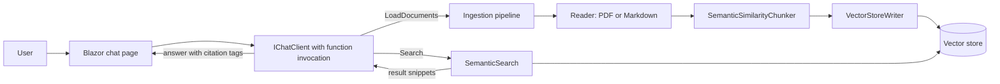
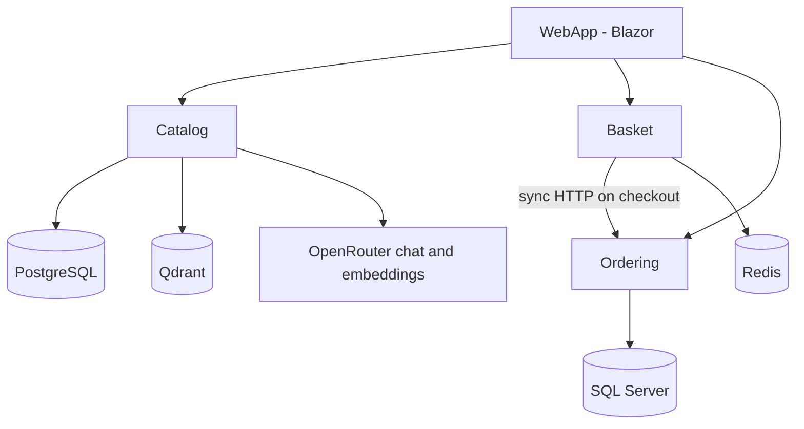

# genai-dotnet

A portfolio of practical Generative AI samples written in C# for .NET 9. The repository progresses from single-file console programs (text completion, embeddings, function calling, image analysis, vector search) to Blazor retrieval-augmented generation (RAG) chat applications and a multi-service .NET Aspire e-commerce system with AI-assisted search and support.

Most samples are built on the [Microsoft.Extensions.AI](https://learn.microsoft.com/dotnet/ai/microsoft-extensions-ai) abstractions (`IChatClient`, `IEmbeddingGenerator`), so the same application code can target hosted APIs or a local [Ollama](https://ollama.com) instance. Where both approaches exist, they are kept as separate projects so the differences are easy to compare.

## Learning Resource and Project Context
This repository contains practical implementations developed while studying [GenAI for .NET: Build LLM Apps with OpenAI and Ollama](https://www.udemy.com/course/genai-for-net-build-llm-apps-with-openai-and-ollama/) by Mehmet Ozkaya.

The projects explore how to integrate Large Language Models (LLMs) into .NET applications, progressing from foundational concepts such as text completion, embeddings and function calling to retrieval-augmented generation (RAG), multimodal AI, vector search and distributed applications built with .NET Aspire.

The repository serves as a hands-on technical portfolio documenting my learning, experimentation and practical application of Generative AI concepts within the .NET ecosystem.

**Scope:** These projects are learning and demonstration implementations, rather than production-ready products. See the individual project sections for implementation details and the current testing status.

## Contents

- [Technology stack](#technology-stack)
- [Projects and implementations](#projects-and-implementations)
- [Key technical capabilities](#key-technical-capabilities)
- [Architecture and design](#architecture-and-design)
- [Prerequisites and getting started](#prerequisites-and-getting-started)
- [Configuration and security](#configuration-and-security)
- [Testing and validation](#testing-and-validation)
- [Repository structure](#repository-structure)
- [Learning outcomes and future improvements](#learning-outcomes-and-future-improvements)

## Technology stack

All projects target `net9.0`. The list below is taken from the project files and source code.

| Area | Technologies |
| --- | --- |
| Language and runtime | C#, .NET 9, nullable reference types |
| AI abstractions | `Microsoft.Extensions.AI`, `Microsoft.Extensions.AI.OpenAI` |
| Model providers | GitHub Models (`models.github.ai`), OpenRouter (`openrouter.ai`), local Ollama via `OllamaSharp` |
| Models referenced in code | `openai/gpt-5-mini`, `openai/gpt-4o-mini`, `openai/text-embedding-3-small`, `llama3.2`, `llava`, `all-minilm` |
| Vector storage | In-memory vector store (`Microsoft.SemanticKernel.Connectors.InMemory`), SQLite (`CommunityToolkit.VectorData.SqliteVec`), Qdrant (`CommunityToolkit.VectorData.Qdrant`, `Aspire.Qdrant.Client`, `Microsoft.SemanticKernel.Connectors.Qdrant`) |
| Document ingestion | `Microsoft.Extensions.DataIngestion` (preview), `PdfPig`, Markdig-based Markdown reader, MarkItDown MCP reader, `Microsoft.ML.Tokenizers` |
| Maths | `System.Numerics.Tensors` (cosine similarity) |
| Web | ASP.NET Core, Blazor (interactive server rendering), minimal APIs |
| Distributed application | .NET Aspire (`Aspire.AppHost.Sdk`), service discovery, OpenTelemetry, HTTP resilience |
| Data stores (eshop-microservices) | PostgreSQL, SQL Server, Redis (distributed cache), Qdrant; Entity Framework Core with migrations |
| Configuration | .NET User Secrets, `appsettings*.json` |

## Projects and implementations

| Project | Purpose | Key technologies | Concept demonstrated |
| --- | --- | --- | --- |
| [TextCompletion](TextCompletion) | Prompting a hosted model | GitHub Models, `openai/gpt-5-mini` | Interactive streaming chat with a system prompt and retained history. Basic completion, streaming, classification, summarisation, sentiment analysis and structured output are provided as commented-out regions to enable one at a time. |
| [TextCompletion_Ollama](TextCompletion_Ollama) | Local equivalent | `OllamaSharp`, `llama3.2` | Same chat loop and prompt scenarios against a local model; no API key. |
| [FunctionCall](FunctionCall) | Tool calling | GitHub Models, `UseFunctionInvocation()`, `AIFunctionFactory` | Registers a `get_current_weather` function that the model can invoke. The function returns randomly generated data, not a real weather service. |
| [Embeddings](Embeddings) | Embedding basics | GitHub Models, `text-embedding-3-small`, `TensorPrimitives` | Generates vectors for "cat", "dog" and "kitten" and compares them by cosine similarity. |
| [VectorSearch](VectorSearch) | Semantic search | OpenRouter embeddings, in-memory vector store | Embeds five movie descriptions, embeds a query, returns the top two matches with scores. |
| [VectorSearch_Ollama](VectorSearch_Ollama) | Local semantic search | `all-minilm` via Ollama, in-memory vector store | Same workflow with a local embedding model. |
| [Vector_Search_Ollama](Vector_Search_Ollama) | Placeholder | None | Contains only the default console template (`Hello, World!`). Not part of `genai-dotnet.sln`. The working implementation is `VectorSearch_Ollama`. |
| [ImageAnalysis](ImageAnalysis) | Vision | OpenRouter, `openai/gpt-5-mini`, `DataContent` | Sends an image (`images/cars.png`) with a question and prints the model's answer. |
| [ImageAnalysis_Ollama](ImageAnalysis_Ollama) | Local vision | `OllamaSharp`, `llava` | Same scenario against a local multimodal model. |
| [TrafficCamAnalysis](TrafficCamAnalysis) | Vision with structured output | OpenRouter, `GetResponseAsync<T>()` | Reads six traffic-camera JPEGs and deserialises each response into a typed `TrafficCamResult` (status, car count, truck count). |
| [ChatApp_RAG](ChatApp_RAG) | RAG chat (hosted models) | Blazor Server, OpenRouter, SQLite vector store, `DataIngestion`, PdfPig | Document ingestion, semantic chunking, vector search and cited answers. |
| [ChatApp_RAG_Ollama](ChatApp_RAG_Ollama) | RAG chat (local models) | Blazor Server, Ollama (`llama3.2`, `all-minilm`), SQLite vector store | Same pipeline with local chat and embedding models; no API key. |
| [ChatApp_RAG_Qdrant](ChatApp_RAG_Qdrant) | RAG chat on Aspire | .NET Aspire, Qdrant container, MarkItDown MCP container, OpenTelemetry | Same RAG application with Qdrant as the vector store and PDF conversion in a separate container. |
| [eshop-microservices](eshop-microservices) | AI features in microservices | .NET Aspire, PostgreSQL, SQL Server, Redis, Qdrant, EF Core | Catalog, Basket and Ordering services and a Blazor front end, with semantic product search and a support assistant. |

### Hosted APIs compared with local Ollama

| Aspect | Hosted variant | Ollama variant |
| --- | --- | --- |
| Authentication | API key or token via User Secrets | None (`http://localhost:11434`, hard-coded in `Program.cs`) |
| Client | `OpenAIClient` pointed at a provider endpoint | `OllamaApiClient` |
| Chat model | `openai/gpt-5-mini` or `openai/gpt-4o-mini` | `llama3.2` (text), `llava` (vision) |
| Embedding model | `openai/text-embedding-3-small` (1,536 dimensions in the RAG apps) | `all-minilm` (384 dimensions in the RAG apps) |
| Cost and privacy | Requests leave the machine | Runs locally; requires local compute and pulled models |

The vector dimension is declared in code and must match the embedding model. `ChatApp_RAG` declares 1,536 and `ChatApp_RAG_Ollama` declares 384. Switching model therefore requires changing `IngestedChunk.VectorDimensions` and rebuilding the vector store.

Differences between the three RAG applications:

| | `ChatApp_RAG` | `ChatApp_RAG_Ollama` | `ChatApp_RAG_Qdrant` |
| --- | --- | --- | --- |
| Models | OpenRouter | Ollama | OpenRouter, wired through the Aspire AppHost |
| Vector store | SQLite file (`vector-store.db`, created in the build output directory) | SQLite file (same) | Qdrant container with a data volume |
| PDF reader | PdfPig (in-process) | PdfPig (in-process) | MarkItDown MCP server (container) |
| Orchestration | Single web project | Single web project | AppHost, ServiceDefaults and Web projects |
| Extra chat tool | `GetTemperature` (simulated) | None | None |

## Key technical capabilities

Each item below is implemented in the named project.

| Capability | Where |
| --- | --- |
| LLM integration through `IChatClient` against GitHub Models, OpenRouter and Ollama | All console samples, RAG apps, Catalog service |
| Prompt-based text generation, system prompts, streaming responses and conversation history | `TextCompletion`, `TextCompletion_Ollama`, RAG apps |
| Structured output (typed JSON responses) | `TrafficCamAnalysis`; commented regions in `TextCompletion` and `TextCompletion_Ollama` |
| Embeddings and cosine similarity | `Embeddings`, `VectorSearch*` |
| Vector search (in-memory, SQLite, Qdrant) | `VectorSearch*`, RAG apps, `eshop-microservices/Catalog` |
| Document ingestion and chunking: PDF and Markdown readers, `SemanticSimilarityChunker`, `VectorStoreWriter` | RAG apps (`Services/Ingestion`) |
| Source-grounded responses: the system prompt requires `<citation filename='...'>` tags, parsed and rendered in the UI | RAG apps (`Chat.razor`, `ChatMessageItem.razor`) |
| Function / tool calling | `FunctionCall`; `LoadDocuments` and `Search` tools in the RAG apps |
| Image analysis (single image, and batch with typed results) | `ImageAnalysis*`, `TrafficCamAnalysis` |
| Distributed microservices: service discovery, Redis caching, EF Core migrations, containerised backing services, OpenTelemetry via ServiceDefaults | `eshop-microservices`, `ChatApp_RAG_Qdrant` |
| AI-assisted features inside a business application: semantic product search and a camping-store support assistant | `eshop-microservices/Catalog`, `WebApp` |

## Architecture and design

The projects do not share one architecture. The two that involve a workflow are described below.

### RAG chat applications

The model decides when to retrieve documents by calling tools; retrieval is not performed on every message.



- Source documents are read from each web project's `wwwroot/Data` folder (`*.pdf` and `*.md`).
- Ingestion runs once per process, the first time documents are needed, and is cached as a single task in `SemanticSearch`. `IncrementalIngestion` is set to `false`.
- Searches can be filtered by file name.
- Dependency injection registers the chat client, embedding generator, vector store and services; the swap between providers happens in `Program.cs`.

### eshop-microservices



- The AppHost declares the backing services and wires references, startup ordering (`WaitFor`) and service discovery (`https+http://catalog`, and similar).
- Catalog stores products in PostgreSQL, applies EF Core migrations on start-up and seeds nine sample products.
- Catalog provides keyword search, semantic search (`/products/aisearch/{query}`, returning the single closest product) and a support endpoint (`/products/support/{query}`). Product embeddings are generated lazily on the first semantic search. The support assistant places the product list in the system prompt; it does not use vector retrieval.
- Basket persists carts in Redis. Checkout calls Ordering synchronously over HTTP. Comments in the code describe an event-based design (message bus) as the intended next step; it is not implemented.
- Ordering persists orders in SQL Server through EF Core.

## Prerequisites and getting started

### Prerequisites

| Requirement | Needed for |
| --- | --- |
| .NET 9 SDK | All projects (all target `net9.0`) |
| .NET 10 SDK | Aspire AppHost projects (`ChatApp_RAG_Qdrant.AppHost`, `eshop-microservices/AppHost`), as stated in the [Aspire prerequisites](https://aspire.dev/get-started/prerequisites/) |
| Visual Studio 2022/2026 or VS Code with the C# Dev Kit | Optional |
| [Ollama](https://ollama.com) with the required models pulled | `*_Ollama` projects |
| Docker Desktop or another supported container runtime | `ChatApp_RAG_Qdrant`, `eshop-microservices` |
| GitHub Models token | `TextCompletion`, `Embeddings`, `FunctionCall` |
| OpenRouter API key | `ImageAnalysis`, `TrafficCamAnalysis`, `VectorSearch`, `ChatApp_RAG`, `ChatApp_RAG_Qdrant`, `eshop-microservices/Catalog` |

Pull the Ollama models used by the local projects:

```powershell
ollama pull llama3.2      # TextCompletion_Ollama, ChatApp_RAG_Ollama
ollama pull all-minilm    # VectorSearch_Ollama, ChatApp_RAG_Ollama
ollama pull llava         # ImageAnalysis_Ollama
```

### Open, restore and build

`genai-dotnet.sln` contains every project except `Vector_Search_Ollama` and `eshop-microservices`. The latter has its own solution, `eshop-microservices/eshop-microservices.sln`.

```powershell
git clone <repository-url>
cd genai-dotnet

dotnet restore genai-dotnet.sln
dotnet build genai-dotnet.sln
```

To build a single project, pass its path, for example `dotnet build TextCompletion`.

### Run a console sample

Configure the required secret first (see [Configuration and security](#configuration-and-security)), then:

```powershell
dotnet run --project TextCompletion
dotnet run --project TextCompletion_Ollama
dotnet run --project FunctionCall
dotnet run --project Embeddings
dotnet run --project VectorSearch
dotnet run --project VectorSearch_Ollama
dotnet run --project ImageAnalysis
dotnet run --project ImageAnalysis_Ollama
dotnet run --project TrafficCamAnalysis
```

The image samples read from an `images` folder copied to the output directory, so run them through `dotnet run` or from the project output directory.

### Run a RAG chat application

```powershell
dotnet run --project ChatApp_RAG --launch-profile https
dotnet run --project ChatApp_RAG_Ollama --launch-profile https
```

Launch profiles (from `Properties/launchSettings.json`):

| Project | HTTPS | HTTP |
| --- | --- | --- |
| `ChatApp_RAG` | `https://localhost:7183` | `http://localhost:5197` |
| `ChatApp_RAG_Ollama` | `https://localhost:7117` | `http://localhost:5226` |

You may need to trust the ASP.NET Core development certificate (`dotnet dev-certs https --trust`). Ensure Ollama is running before starting `ChatApp_RAG_Ollama`.

### Run the Aspire applications

Start the container runtime, then run the AppHost:

```powershell
dotnet run --project ChatApp_RAG_Qdrant/ChatApp_RAG_Qdrant.AppHost
dotnet run --project eshop-microservices/AppHost
```

The AppHost launches the services and containers and opens the Aspire dashboard (`https://localhost:17125` for `ChatApp_RAG_Qdrant`, `https://localhost:17229` for `eshop-microservices`, per their launch profiles). In Visual Studio, set the relevant AppHost as the startup project instead.

## Configuration and security

Not every project uses User Secrets. The table lists what the code reads.

| Project | Configuration key | Source |
| --- | --- | --- |
| `TextCompletion`, `Embeddings`, `FunctionCall` | `GitHubModels:Token` | User Secrets (loaded explicitly in code) |
| `ImageAnalysis`, `TrafficCamAnalysis`, `VectorSearch` | `OpenRouter:ApiKey` | User Secrets (loaded explicitly in code) |
| `ChatApp_RAG` | `OpenRouter:ApiKey` | ASP.NET Core configuration (User Secrets in Development, or environment variables) |
| `ChatApp_RAG_Qdrant.AppHost` | `Parameters:openai-openai-apikey` | Aspire secret parameter created by `AddOpenAI("openai")`; the endpoint is set to OpenRouter in `AppHost.cs` |
| `eshop-microservices/Catalog` | `OpenRouter:ApiKey` | User Secrets (loaded explicitly in code) |
| `VectorSearch_Ollama`, `TextCompletion_Ollama`, `ImageAnalysis_Ollama`, `ChatApp_RAG_Ollama`, `Vector_Search_Ollama`, `eshop-microservices` Basket, Ordering, WebApp | None required | n/a |

Set secrets from the repository root. Replace the placeholders with your own values and never commit them:

```powershell
dotnet user-secrets set "GitHubModels:Token" "<YOUR_GITHUB_MODELS_TOKEN>" --project TextCompletion
dotnet user-secrets set "OpenRouter:ApiKey" "<YOUR_OPENROUTER_API_KEY>" --project ChatApp_RAG
dotnet user-secrets set "Parameters:openai-openai-apikey" "<YOUR_OPENROUTER_API_KEY>" --project ChatApp_RAG_Qdrant/ChatApp_RAG_Qdrant.AppHost
dotnet user-secrets set "OpenRouter:ApiKey" "<YOUR_OPENROUTER_API_KEY>" --project eshop-microservices/Catalog
```

Repeat the first two forms for each project that needs the same key. Each project has its own `UserSecretsId`, so secrets are stored per project outside the repository.

Notes:

- Provider endpoints in the code are the public GitHub Models and OpenRouter URLs; the Ollama endpoint is `localhost`. No credentials are stored in the repository's `appsettings*.json` files.
- `.gitignore` excludes `secrets.json`, `.env` files, user-specific project files, build output and local databases.
- The `README.md` files inside the three RAG projects originate from the project template and in places describe other providers (for example `OpenAI:Key` or Azure provisioning). The code and this document reflect the configuration actually used.

## Testing and validation

The repository contains no test projects, test framework references or CI workflow, so there are no automated test results to report.

| Status | Detail |
| --- | --- |
| Substantiated by the repository | Project and solution files; EF Core migrations for Catalog and Ordering; configuration keys and model names as read from source. |
| Not verified during preparation of this README | Building the full solution; running any sample against a live provider or local Ollama; Aspire start-up and container orchestration; semantic search quality; RAG answer accuracy. |

Behaviour that depends on external providers (GitHub Models, OpenRouter, Ollama) will vary with model availability, quotas and model versions.

## Repository structure

```text
genai-dotnet/
├── genai-dotnet.sln              # Main solution (all projects except Vector_Search_Ollama and eshop-microservices)
├── TextCompletion/               # Console: prompts, streaming chat (GitHub Models)
├── TextCompletion_Ollama/        # Console: same, local Ollama
├── FunctionCall/                 # Console: tool calling
├── Embeddings/                   # Console: embeddings and cosine similarity
├── VectorSearch/                 # Console: in-memory vector search (OpenRouter)
├── VectorSearch_Ollama/          # Console: in-memory vector search (Ollama)
├── Vector_Search_Ollama/         # Placeholder console template
├── ImageAnalysis/                # Console: vision (OpenRouter)
├── ImageAnalysis_Ollama/         # Console: vision (Ollama)
├── TrafficCamAnalysis/           # Console: vision with structured output
├── ChatApp_RAG/                  # Blazor RAG chat (OpenRouter, SQLite)
├── ChatApp_RAG_Ollama/           # Blazor RAG chat (Ollama, SQLite)
├── ChatApp_RAG_Qdrant/           # Aspire: AppHost, ServiceDefaults, Web (Qdrant)
└── eshop-microservices/          # Separate Aspire solution: AppHost, ServiceDefaults,
                                  #   Catalog, Basket, Ordering, WebApp
```

The root solution groups projects into solution folders named `section5_llms`, `section6_vectors`, `section7_rag` and `section8_vision`. `eshop-microservices` is a self-contained Aspire solution with its own `.sln` and `aspire.config.json`; it is committed in the same repository but is not referenced by `genai-dotnet.sln`, and it builds and runs independently.

## Learning outcomes and future improvements

### Skills demonstrated

- Provider-agnostic AI integration with `Microsoft.Extensions.AI`, including a hosted-versus-local comparison.
- Designing RAG pipelines: ingestion, chunking, embedding, vector storage, tool-based retrieval and citation handling.
- Typed (structured) model output and multimodal input.
- Building AI features into a service-based application with .NET Aspire, EF Core, Redis and Qdrant.
- Secret handling with User Secrets and environment-specific configuration.

### Possible improvements

- Add automated tests (unit tests for services and endpoints; integration tests for the Aspire applications) and a CI workflow.
- Replace the simulated weather tools in `FunctionCall` and `ChatApp_RAG` with a real API or an explicitly labelled mock.
- Move Catalog embedding initialisation to start-up or a background job, as noted in the code.
- Replace the synchronous Basket-to-Ordering call with an event-driven flow, as noted in the code.
- Reduce duplication across the three RAG applications through a shared library.
- Externalise model names and the Ollama endpoint into configuration rather than constants in `Program.cs`.
- Add a licence file.
